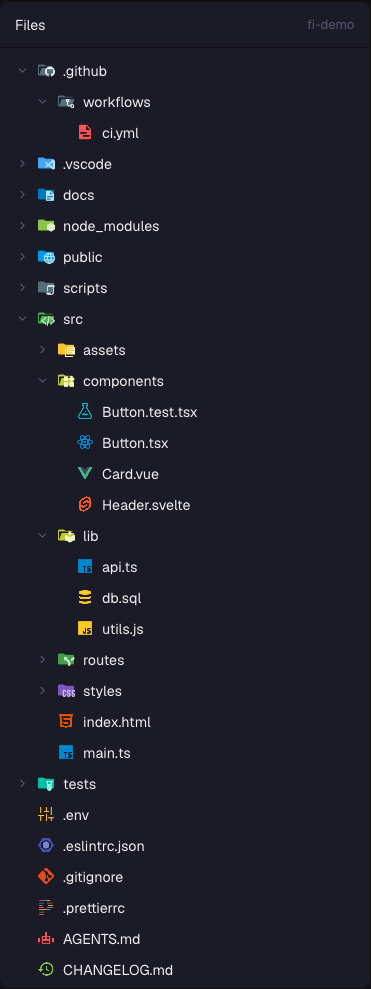
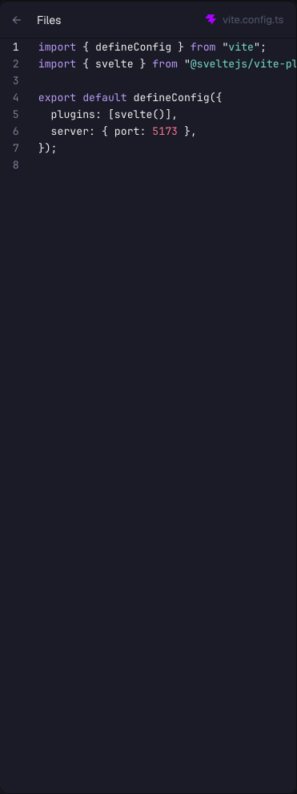

# File Icons

**Herdr's Files panel with VS Code's file icons.** Every file and folder in the tree gets its Material Icon Theme icon, so you can tell `.ts` from `.tsx`, `package.json` from `tsconfig.json` and `src/` from `tests/` without reading.

A mod for the [Herdr](https://herdr.dev) desktop app. It replaces the shipped `files` panel.

<table>
  <tr>
    <td align="center"></td>
    <td align="center"></td>
  </tr>
  <tr>
    <td align="center"><sub>The tree</sub></td>
    <td align="center"><sub>An open file</sub></td>
  </tr>
</table>

## What it does

- **1184 icons** from [Material Icon Theme](https://github.com/material-extensions/vscode-material-icon-theme), the VS Code icon theme, in full color.
- **Matched like VS Code:** by path (`.github/FUNDING.yml`), file name (`Dockerfile`, `package.json`, `CLAUDE.md`), then the longest extension (`app.spec.ts` is a test, `app.ts` is TypeScript).
- **Named folders:** `src`, `components`, `tests`, `__tests__`, `.github`, `node_modules`, `docs`, `public` and hundreds more get their own colored folder, and switch to the open version when expanded.
- **Light themes** use the theme's light variants where it has them.
- Everything else is Herdr's own Files panel: follows the focused pane's folder, git marks, live refresh, read-only preview.

## Install

1. Copy `mods/file-icons/` to `~/.config/herdr-app/mods/`.
2. Point your layout's Files block at it. Herdr's shipped layouts are read-only, so if you use one, clone it first:

   ```sh
   herdr-app do layout.clone '{"name":"main","as":"my-main"}'
   ```

   Then in `~/.config/herdr-app/layouts/my-main.json` (or your own layout), find the block with `"id": "files"` and change its `"mod": "files"` to `"mod": "file-icons"`. Keep the id.
3. Check it:

   ```sh
   herdr-app check ~/.config/herdr-app/mods/file-icons
   ```

Or ask your agent to add it: it reads [RECIPE.md](RECIPE.md) and does the above.

## What it touches

- Runs `sh` (`powershell` on Windows) to list the shown folder and `git` for the change marks, and reads files there when you open them, exactly like Herdr's own Files panel.
- No network. Assets come only from its own folder.

## Updating the icons

```sh
node tools/build-icons.mjs            # the pinned version, 5.40.0
node tools/build-icons.mjs 5.41.0     # another one
```

Downloads `material-icon-theme` with `npm pack` and regenerates `mods/file-icons/icons/` and `icons.js`.

## Rebuild from scratch

[RECIPE.md](RECIPE.md) is the full brief: what you see, how it behaves, what it's built from and what to watch out for. An agent can rebuild the mod from it with an empty folder, for example on a Herdr version where these files no longer work.

## License

Code: Apache-2.0, see [LICENSE](LICENSE). Built from Herdr's shipped `files` mod. Icons: [Material Icon Theme](https://github.com/material-extensions/vscode-material-icon-theme), MIT, see [mods/file-icons/LICENSE-material-icon-theme.txt](mods/file-icons/LICENSE-material-icon-theme.txt). Chevrons: [Lucide](https://lucide.dev), ISC, see [LICENSE-Lucide.txt](LICENSE-Lucide.txt).
