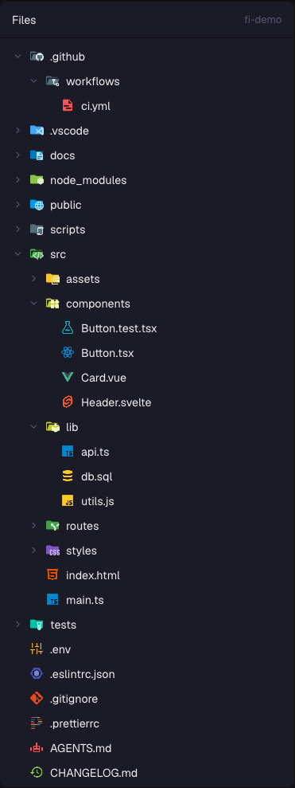

# File Icons

Herdr's Files panel with the icons you know from VS Code: every file and folder in the tree gets the colored icon the Material Icon Theme gives it, so `.ts`, `package.json`, `Dockerfile`, `src/`, `tests/` and `node_modules/` are recognisable at a glance. Folders switch to their open icon when you expand them, and the file preview shows the file's icon next to its name. This is a piece you add to your current layout, not a whole window.



This file is the brief: enough to build File Icons from an empty folder. The files next to it are one build of it. If they don't work on your Herdr, or you want it different, build it again from here.

## What you see

- The same panel as Herdr's own Files panel, wherever your layout puts it (in Herdr's `main` layout: the right-hand panel, opened with the Files button in the tab bar). Same background, 1px border, 10px rounded corners.
- **Header**, 42px: "Files" in semibold, and on the right in 12px dim text the folder's name. While a file is open: a `←` on the left, and on the right the file's icon at 14px followed by its path.
- **Tree**, 6px padding, rows 28px high with 7px rounded hover in the theme's hover color, text 13px:
  - 8px left padding plus 18px per level of nesting;
  - a 12px chevron (right when closed, down when open) for folders, an empty 12px slot for files, tinted with the theme's dim color;
  - the item's **icon, 16px, in its own colors** (not tinted): TypeScript's blue "TS", JavaScript's yellow "JS", React's atom for `.tsx`, a flask for `.test.tsx`/`.spec.ts`, Svelte's orange S, Vue's green V, Docker's whale, a git diamond for `.gitignore`, a node hexagon for `package.json`, and so on: 1184 icons. Folders with a known name are colored folders with a badge (`src` green with `</>`, `components` yellow with a puzzle piece, `.github` with the Octocat, `node_modules` green with a node hexagon, `tests` teal); other folders are a plain grey folder.
  - the name, truncated with an ellipsis;
  - the git mark on the right in 11px: `A` (added or untracked) in ansi green, `M` in the theme's blocked color, `D` and `U` in ansi red.
- Folders come first, then files, each alphabetical. `.git` is never listed.
- An open file replaces the tree with a read-only code view (12px, the terminal font, line numbers, syntax colors from the theme's ansi colors).
- Empty states in 12px dim text: "Loading files…", "No files", "No folder", or the error. Past the limits: "File list limited to 500 entries per folder and 5,000 total".

## How it behaves

| Action | Result |
| --- | --- |
| Click a folder | Opens or closes it; its icon switches between the closed and the open version (`folder-src` ↔ `folder-src-open`) |
| Click a file | Shows it in the panel, with its icon in the header |
| `←` | Back to the tree |
| Focus another pane | The panel follows that pane's folder (on its machine, for remote spaces) |
| Light theme | Icons that have a light version use it: 179 file names, 32 extensions and 5 folders, e.g. `toml`, `bun.lock`, `jinja`, `.idea` |

How an icon is chosen, the way VS Code does it with Material Icon Theme; names are compared in lower case:

1. **A path rule:** the end of the item's path inside the folder matches a rule with a slash (`.github/funding.yml`, `github/issue_template`).
2. **A file name** (`package.json`, `dockerfile`, `claude.md`, `vite.config.ts`) or **folder name** (`src`, `tests`, `node_modules`). Folder names also match with a leading `.`, `_` or `-`, or wrapped in `__…__` (`__tests__` is `tests`).
3. **For files, the extension, longest first:** `app.spec.ts` tries `spec.ts` before `ts`; `.env.local` tries `env.local`, then `local`.
4. Otherwise the plain `file` or `folder` icon.

The panel has no agent statuses. It refreshes every 10 seconds and whenever something in the folder changes (local spaces); open folders stay open across refreshes and are forgotten when the folder changes.

## Built from

- **One mod**, `mods/file-icons/`. Its `main.js` is a copy of Herdr's shipped `files` mod (the Files panel) with three changes: a `DIR` constant holding the folder for every asset path, an `icon(path, dir, open, dark)` function that returns `${DIR}/icons/<id>.svg`, and the rows and header drawing that icon with `image(...)` instead of the shipped one-color `svg(...)` file/folder glyphs.
  - `mod.json`: `{ "place": "none" }` (it only appears where a layout puts it).
  - `chevron-down.svg`, `chevron-right.svg`: Lucide glyphs (ISC), drawn with `svg()` so they tint.
  - `icons/`: 1184 SVGs from **Material Icon Theme 5.40.0** (MIT, https://github.com/material-extensions/vscode-material-icon-theme), each saved as `<icon id>.svg`, and its licence as `LICENSE-material-icon-theme.txt`.
  - `icons.js`: `export default { file, folder, fileNames, fileExtensions, folderNames, light: { fileNames, fileExtensions, folderNames } }`, every key in lower case, each value an icon id. About 120 KB.
- **The generator**, `tools/build-icons.mjs` at the repo root (Node, no dependencies; runs `npm pack material-icon-theme@<version>` and `tar`). It reads the package's `dist/material-icons.json`, lower-cases the tables, keeps of every folder name's five spellings only those the mod's normalisation doesn't already reach (4674 keys become 935), copies every icon the tables can name plus each folder icon's `-open` twin, and writes `icons/` and `icons.js`. `node tools/build-icons.mjs 5.41.0` moves to another version.
- **Your layout uses it** instead of `files`: in the block with `"id": "files"`, set `"content": { "mod": "file-icons" }`. Keep the block's id: the tab bar's Files button selects the block by id. Herdr's own layouts are read-only, so clone yours first:

  ```sh
  herdr-app do layout.clone '{"name":"main","as":"my-main"}'
  ```

- **`herdr` functions** (as the shipped mod): `spaces`, `panes`, `focused` for the folder; `exec` to list it (`sh`, or `powershell` on Windows) and for `git rev-parse` / `git status`; `watchFolder`, `readTextFile`, `theme`, `settings` (`settings().dark` picks the light icons), `window`. From gpui-kit: `image`, `svg`, `Editor`, `EditorState`.
- It runs `sh`/`powershell` and `git` in the shown folder, like Herdr's own Files panel; it reads files there to preview them. No network. Assets come only from its own folder.

## Watch out

- **Use `image()`, not `svg()`, for the icons.** `svg()` tints every path with the text color and the icons turn into grey silhouettes.
- **Open folders:** the manifest's expanded table is always the closed id plus `-open`, and for light ones `<name>-open_light` from `<name>_light`. Derive it; don't ship the second table.
- **Icon files are renamed.** Some of the theme's files are named `<id>.clone.svg`; the mod looks them up by id, so the generator saves each as `<id>.svg` from the manifest's `iconPath`.
- **Folder spellings:** the manifest lists every folder five times (`src`, `.src`, `_src`, `-src`, `__src__`). The mod strips `__…__`, then one leading `.`, `_` or `-`, and tries the name both as it is and stripped; a path rule is tried the same way (`.github/issue_template` → `github/issue_template`).
- **No language detection.** VS Code also picks icons by the language it detects in a file (`languageIds`); this panel only sees names. Most languages are covered by extension anyway, but e.g. `.github/workflows/ci.yml` shows the YAML icon, not the GitHub Actions one.
- The panel's root is the focused pane's folder, so path rules match from there: `.github/funding.yml` is found when the pane sits in the repo root.
- Never edit the shipped `files` mod in place: on the next start Herdr moves an edited shipped mod to `files-edited` and restores its own.
- The rows' limits come from the shipped panel: 500 entries per folder, 5,000 in total, 40 levels deep.
- Follow the installed `herdr.d.ts` and `gpui-kit.d.ts`.

## Done when

- `herdr-app check mods/file-icons` passes with the matching Herdr binary and home.
- With your layout's Files block pointing at `file-icons`, the Files button shows the panel with colored icons: `main.ts` the TypeScript icon, `package.json` the node icon, `.gitignore` the git icon, an unknown `x.foo` the plain file icon.
- Opening `src/` changes its icon from `folder-src` to `folder-src-open`; an unknown folder from `folder` to `folder-open`.
- `src/app.spec.ts` shows the test icon (`test-ts`), not TypeScript's.
- `__tests__/` and `.github/` get the test and GitHub folder icons; `.github/FUNDING.yml` the GitHub Sponsors heart.
- Clicking `vite.config.ts` shows the Vite icon and the path in the header, and the code below.
- In a light theme, `Cargo.toml` shows `toml_light`.
